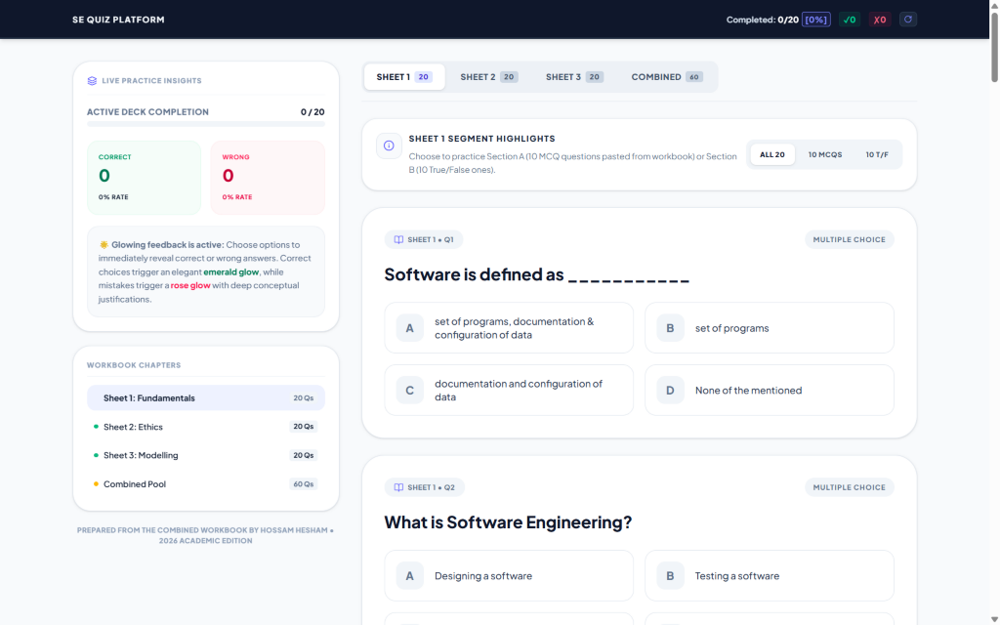
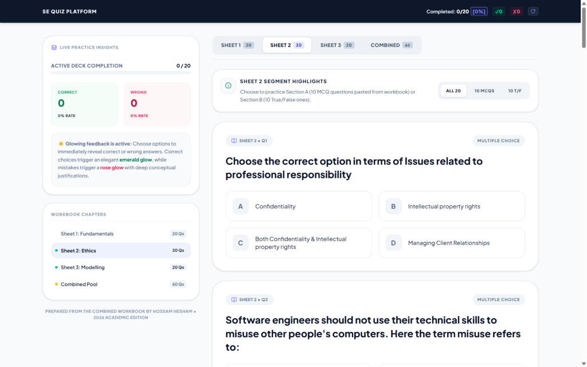
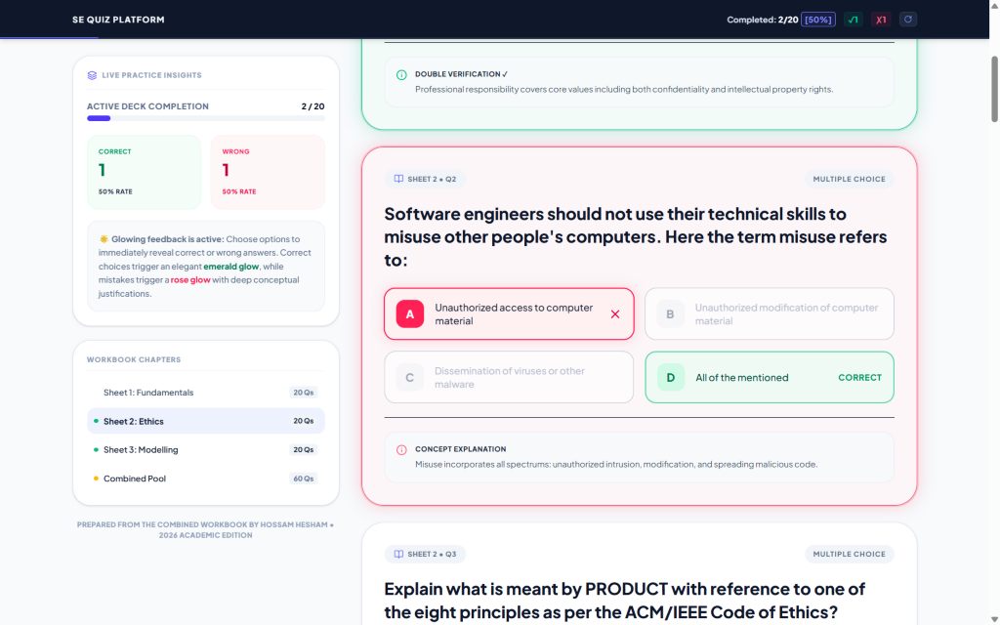
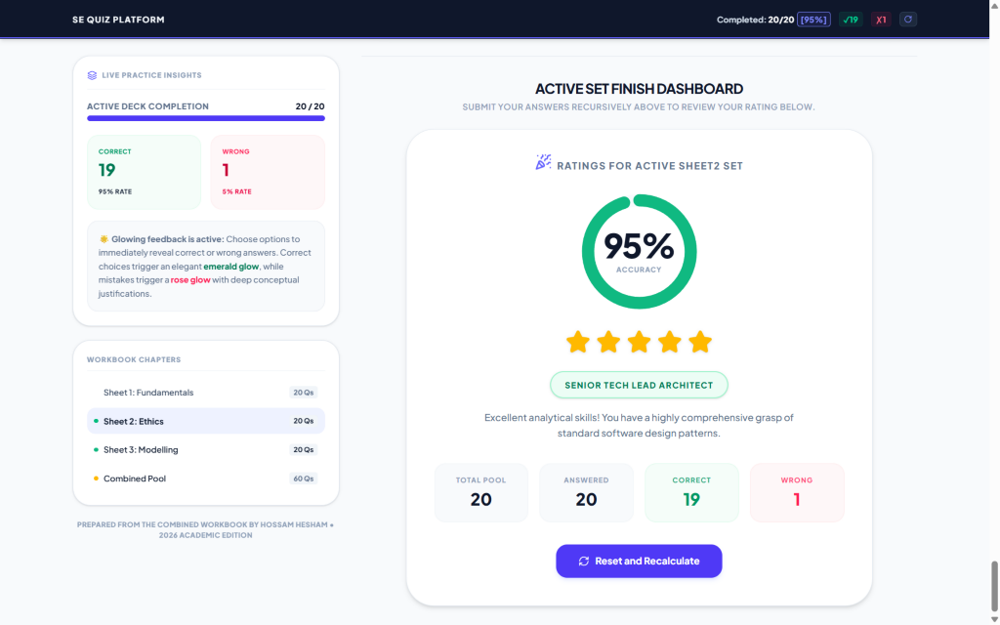

<div align="center">



# SWE Quiz | منصة اختبارات هندسة البرمجيات

**تطبيق ويب تفاعلي لاختبارات هندسة البرمجيات بـ React و TypeScript و Vite — Interactive Software Engineering Quiz Platform**

[](https://react.dev)
[](https://vitejs.dev)
[](https://www.typescriptlang.org)
[](#)

[✨ Features](#-about-swe-quiz) · [🖥️ App Showcase](#-platform-showcase--every-screen-explained) · [🏗️ Architecture](#-architecture--tech-stack) · [🚀 Getting Started](#-getting-started)

</div>

---

## ✨ About SWE Quiz

**SWE Quiz** is a fast, strongly-typed interactive web application for practicing and mastering **Software Engineering** concepts, built with **React**, **TypeScript**, and **Vite**.

- 📚 **60 Structured Questions Across 3 Chapters:** Covers *Sheet 1: Fundamentals* (20 Qs), *Sheet 2: Ethics* (20 Qs), *Sheet 3: Modelling* (20 Qs), plus a *Combined Pool* (60 Qs) with instant filters (`All 20`, `10 MCQs`, `10 T/F`).
- ✨ **Instant Glowing Feedback & Explanations:** Selecting an answer locks the card with an **emerald glow** + *Double Verification ✓* for correct picks, or a **rose glow** highlighting the right choice + *Concept Explanation* for missed questions.
- 📊 **Live Practice Insights Sidebar:** Sticky progress header and sidebar tracking completion count, accuracy percentage, and correct/wrong tallies in real time.
- 🏆 **Active Set Finish Dashboard:** Circular accuracy ring, 5-star tier ranking (*Junior Code Analyst* → *Senior Tech Lead Architect*), summary stat tiles, and instant *Reset & Recalculate*.

---

## 🖥️ Platform Showcase — Every Screen Explained

| Main Dashboard & Workbook Setup · الصفحة الرئيسية | Chapter Switcher & Question Cards · الأسئلة |
| :---: | :---: |
|  |  |

| Instant Glowing Validation & Explanations · التصحيح الفوري | Active Set Finish Dashboard (95% Accuracy) · ملخص النتيجة |
| :---: | :---: |
|  |  |

---

## 🏗️ Architecture & Tech Stack

| Layer | Technology |
| :--- | :--- |
| **Frontend Framework** | React · TypeScript (`99.2%`) |
| **Build Tooling** | Vite 6 (`vite.config.ts`) |
| **Data Modeling** | Strictly-typed TypeScript interfaces (`src/types.ts`, `src/questionsData.ts`) |

```text
quiz/
├── docs/
│   ├── banner.png           # Hero showcase banner
│   └── screenshots/         # 4 live desktop UI screenshots
├── src/
│   ├── components/          # Modular quiz UI components
│   ├── App.tsx              # Main quiz workflow & state orchestration
│   ├── questionsData.ts     # Structured 60-question SWE question bank
│   └── types.ts             # TypeScript domain interfaces
└── package.json             # Dependencies & scripts
```

---

## 🚀 Getting Started

```bash
git clone https://github.com/zxrelking/quiz.git
cd quiz
npm install
npm run dev
```

---

<div align="center">
  <sub>Built with ❤️ using React, TypeScript & Vite — <strong>SWE Quiz</strong></sub>
</div>
